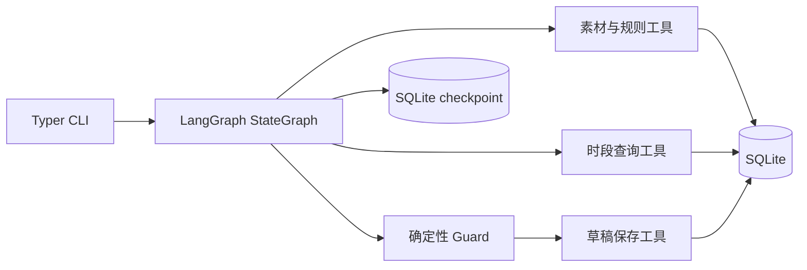

# 素材审核与发布排期 Agent

小影科技笔试题 1 的实现：一个基于 **LangGraph + Python CLI + SQLite** 的 Agent。它读取素材、执行审核规则、检查排期冲突、提出替代时段、暂停等待用户确认，并且只保存**草稿**。

> 安全边界：项目没有 `publish` 工具、真实发布 API 或 `published` 数据状态。所有成功结果都明确为“草稿已保存，尚未发布”。

## 核心能力

- 审核素材元数据，识别缺失字段和规则风险。
- 查询已有排期和已保存草稿，避免时段冲突。
- 在 M01 的 18:00 已占用时建议 19:00，并用 LangGraph `interrupt/resume` 等待用户确认。
- 用 SQLite 唯一约束实现请求幂等和同一 scope/时段的排他占用。
- 保存失败如实返回 `failed`；不会伪报草稿已保存。
- LLM 只能在确定性 Guard 给出的合法动作集中做选择，永远不能发布、覆盖硬性要求或直接写数据库。

交付文档从 [`docs/01-requirements.md`](docs/01-requirements.md) 开始；面试演示脚本见 [`docs/demo-script.md`](docs/demo-script.md)，可提交的验收说明与证据索引见 [`docs/03-evaluation.md`](docs/03-evaluation.md)。

## 快速开始

要求：Python 3.11+。

```powershell
cd xiaoying-q1-material-scheduling-agent
python -m pip install -r requirements.txt
python main.py --help
```

默认数据库是 `data/material_scheduler.db`。演示时建议显式指定一个临时数据库路径。

```powershell
# 初始化确定性演示素材：M01-M04、18:00 占用、19:00 可用
python main.py demo seed --database data/demo.db

# 正常排期：M02 的 20:00 可用，保存草稿
python main.py demo normal --database data/demo.db

# 参考案例：M01 的 18:00 冲突，建议 19:00，等待确认
python main.py demo conflict --database data/demo.db

# 查询 run_id 后确认 19:00，恢复同一个 LangGraph checkpoint
python main.py list-runs --database data/demo.db
python main.py resume --run-id RUN_ID --confirm --time "2026-10-28T19:00:00+08:00" --database data/demo.db
```

## 通用 CLI

```powershell
python main.py schedule `
  --material-id M01 `
  --time "2026-10-28T18:00:00+08:00" `
  --requirement preferred `
  --scope main `
  --max-steps 24 `
  --database data/demo.db

python main.py resume `
  --run-id RUN_ID `
  --confirm `
  --time "2026-10-28T19:00:00+08:00" `
  --database data/demo.db

python main.py show --run-id RUN_ID --database data/demo.db
python main.py list-runs --database data/demo.db
```

可重复执行的验收演示：

```powershell
python main.py demo normal --database data/normal.db
python main.py demo conflict --database data/conflict.db
python main.py demo missing-info --database data/missing.db
python main.py demo rule-risk --database data/risk.db
python main.py demo duplicate --database data/duplicate.db
python main.py demo save-failure --database data/failure.db
```

## 决策与持久化边界



- `tools/` 只有素材读取、规则检查、时段查询和草稿保存四类受控能力。
- Guard 会拒绝未审核、未确认、非候选替代时段或时段冲突的保存尝试。
- 相同请求在时段查询前按请求指纹复用既有草稿；避免“第二次请求先看到自身草稿占用、再被错误引导到替代时段”的问题。
- 所有时段先转为 `Asia/Shanghai`、ISO 秒精度，因此 `10:00Z` 与 `18:00+08:00` 不会绕过冲突和幂等检查。
- 每次运行默认最多执行 `24` 个业务节点，可通过 `--max-steps` 调整；达到上限时返回 `execution_status: incomplete` 和 `EXECUTION_LIMIT_REACHED`，不会创建草稿。

## 真实 LLM（可选）

LLM 通过 OpenAI 兼容接口接入，配置变量在 [`.env.example`](.env.example) 中列出：

```powershell
$env:LLM_BASE_URL = "https://your-openai-compatible-endpoint/v1"
$env:LLM_API_KEY = "your-key"
$env:LLM_MODEL = "your-model"
```

项目会加载根目录可选 `.env`；PyCharm 或 shell 中已设置的变量优先。没有上述配置时，Agent 会在 stderr 输出简短提示，并使用确定性、受限的本地动作选择器用于离线演示；审核、时段检查、确认与草稿写入仍然走真实 LangGraph 和 SQLite。

真实 LLM 未配置时，不能把离线测试称为“真实 LLM 已验证”。

## 验证

```powershell
python -m pytest -v
python main.py --help
python scripts/generate_examples.py
```

测试使用真实 SQLite、LangGraph、工具函数和 CLI。覆盖正常排期、信息缺失、规则阻断、时段冲突、确认恢复、幂等、防重复、等价时区、保存失败和非法 LLM 动作回退。

`examples/` 保存可提交的验证材料：每个例子都包含输入、实际 JSON 输出和节点 Trace；可通过 `python scripts/generate_examples.py` 重新生成。

在配置真实 LLM 后，可额外生成不含密钥和网关地址的在线决策证据：

```powershell
python scripts/record_live_llm_evidence.py
```

本项目当前提交的 [`examples/05-live-llm-decision.md`](examples/05-live-llm-decision.md) 已由一次成功的真实在线调用生成，记录为 `source: live_llm`。
完整的在线冲突处理链路证据见 [`examples/06-live-llm-conflict-flow.md`](examples/06-live-llm-conflict-flow.md)。
完整的在线正常保存链路证据见 [`examples/08-live-llm-normal-flow.md`](examples/08-live-llm-normal-flow.md)。

## 非目标

- 不接真实发布平台。
- 不提供 HTTP API、PySide6 UI、PostgreSQL、多租户或权限系统。
- 不让 LLM 直接访问数据库或调用任意工具。
